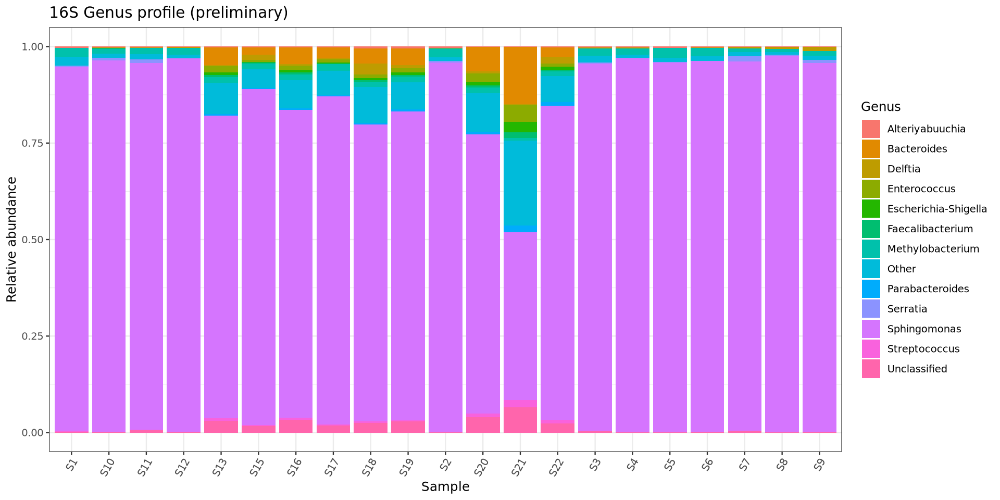
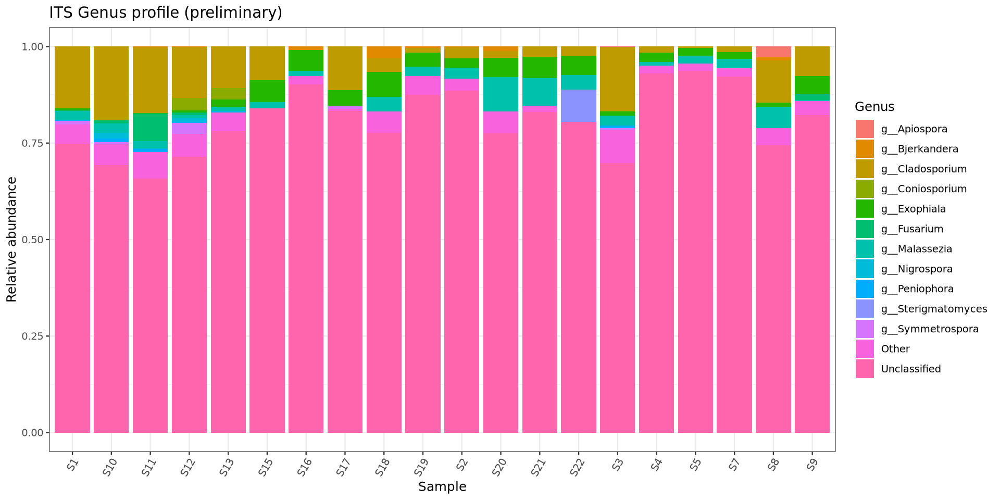

# Atmospheric Microbiome: 16S, ITS and Shotgun

**Amplicon-sequencing workflows, analysis results and a developing shotgun workflow for the atmospheric microbiome.**

This repository documents the re-analysis of bacterial 16S rRNA and fungal ITS sequencing data from **Rodó et al. (2024), PNAS**, and provides a starting point for future research on microbial community composition, atmospheric transport and extreme weather. The **16S and ITS notebooks have been executed** on the study data; the **shotgun workflow is a draft and has not yet been validated on a complete dataset**.

## 1. Analysis status and key results

| | 16S rRNA (bacteria) | ITS (fungi) |
|---|---:|---:|
| Processed samples | **21** (10 Flight, 11 Ground) | **20** (10 Flight, 10 Ground) |
| Raw paired-end read pairs | 2,091,511 | 3,707,744 |
| Non-chimeric merged reads | 1,155,686 | 1,932,395 |
| Target-group reads after taxonomic filtering | **1,154,733** | **1,645,078** |
| ASVs before taxonomic filtering | 2,507 | 1,105 |
| Target-group ASVs | **2,469 bacterial ASVs** | **885 fungal ASVs** |
| Bray–Curtis PERMANOVA, Flight vs Ground | R² = 0.0362; p = 0.522 | R² = 0.0430; p = 0.602 |
| Status | Executed | Executed |

**Interpretation:** The current ASV-level analyses did not detect a statistically significant Flight–Ground community-composition difference. This does *not* establish equivalence between the groups. The PERMANOVA values shown above use 999 permutations and the individual amplicon-marker datasets.

The processed sample sets are not identical: the available FASTQ data yielded 21 bacterial samples and 20 fungal samples. The manuscript describes 22 collected aerosol samples; not all have usable FASTQ data for both markers in the dataset analyzed here.

### Taxonomic filtering

- **16S:** DADA2 inferred 2,507 non-chimeric ASVs. Organellar ASVs (chloroplast/mitochondria) and ASVs without a confidently assigned bacterial domain were removed from the primary bacterial analysis, leaving **2,469 ASVs**. Complete and filtered tables are retained separately.
- **ITS:** UNITE assigned **885 ASVs to `k__Fungi`**. The remaining 220 ASVs (12 assigned to `k__Viridiplantae` and 208 without a kingdom assignment) are excluded from the *fungal-only* analysis but remain in the unfiltered output. Unassigned does not necessarily mean non-fungal.

Relative abundances describe sequencing reads, **not** absolute airborne microbial concentrations.

## 2. Repository contents

```text
.
├── AirLab_16S_FROM_RAW.ipynb      # Executed 16S FASTQ -> DADA2 -> ecology
├── AirLab_ITS_FROM_RAW.ipynb      # Executed ITS FASTQ -> DADA2 -> ecology
├── shotgun.Rmd                   # Draft shotgun taxonomic/ecological workflow
├── config.yaml                   # Configuration for the earlier Rmd-based setup
├── run.sh                        # Earlier Rmd launcher; see warning below
├── env/environment.yml          # Conda environment specification
├── metadata/
│   ├── samples_pnas.tsv          # Sample-level metadata from study supplements
│   ├── metadata_schema.md
│   └── *_template.tsv
└── results/
    ├── 16S/                     # Exported bacterial results
    └── ITS/                     # Exported fungal results
```

### Key outputs in each `results/<marker>/` directory

| File | Content |
|---|---|
| `read_tracking.tsv` | Per-sample reads at each filtering/denoising/merging stage |
| `asv_counts_all.tsv` / `asv_counts_target.tsv` | ASV counts before / after target-group filtering |
| `taxonomy_all_asvs.tsv` / `taxonomy_target.tsv` | Taxonomic assignments before / after filtering |
| `taxonomy_filter_audit.tsv` | Audit of excluded ASVs |
| `asv_sequences_all.fasta` | ASV nucleotide sequences |
| `metadata_target.tsv` | Sample metadata used for the ecological analysis |
| `phyloseq.rds` | R object containing target-group counts, taxonomy and metadata |
| `alpha_diversity.tsv` | Sample-level alpha-diversity metrics |
| `relative_genus.tsv` | Genus-level relative abundance table |
| `bray_curtis.tsv`, `jaccard.tsv`, `pcoa_bray.tsv` | Community distances and ordination coordinates |
| `permanova_flight_ground.txt`, `betadisper_flight_ground.txt` | Flight–Ground statistical tests |
| `*.png` | Rarefaction, alpha-diversity, genus profiles and PCoA plots |
| `sessionInfo.txt`, `tool_versions.txt` | Recorded R session and external-tool versions |

For ITS, `phyloseq_all_ITS_asvs.rds` additionally retains the **unfiltered** ITS community.

### Example outputs

| 16S bacterial genus profiles | ITS fungal genus profiles |
|---|---|
|  |  |

Genus-level plots should be interpreted with care: not all reads and ASVs can be classified reliably to genus, especially for ITS.

## 3. Amplicon workflows (executed)

The current, **tested** entry points are the two Jupyter notebooks:

- [`AirLab_16S_FROM_RAW.ipynb`](AirLab_16S_FROM_RAW.ipynb): bacterial 16S rRNA; **SILVA v144** taxonomy.
- [`AirLab_ITS_FROM_RAW.ipynb`](AirLab_ITS_FROM_RAW.ipynb): fungal ITS; **UNITE v10.0** taxonomy.

Processing sequence:

**Paired FASTQ → FastQC / MultiQC → Cutadapt primer trimming → DADA2 quality filtering, error learning, denoising, paired-read merging and chimera removal → ASVs → SILVA/UNITE taxonomic classification → target-group filtering → phyloseq → alpha/beta diversity and exploratory statistics.**

The notebooks also report read retention, export intermediate audit tables and calculate Bray–Curtis / Jaccard distances, PCoA and Flight–Ground PERMANOVA / dispersion tests. They use `minBoot = 80` for taxonomic assignment and `pooling = "pseudo"` in DADA2; consult the setup cells for the full run-specific settings. The 16S notebook also uses DADA2 species matching against a SILVA species reference.

### Running the notebooks on another machine

1. Obtain paired FASTQ files from **ENA accession [PRJEB64345](https://www.ebi.ac.uk/ena/browser/view/PRJEB64345)**. Expected names in the current notebooks are `S1_1_16S.fastq.gz` / `S1_2_16S.fastq.gz` and the analogous `_ITS.fastq.gz` files.
2. Install the required R and command-line tools. [`env/environment.yml`](env/environment.yml) is a starting specification; the executed cluster environment and package versions are recorded in the results directories.
3. Download the appropriate **SILVA v144** and **UNITE v10.0** classification reference files separately. They are not stored in this repository.
4. Open the appropriate `.ipynb` file in **JupyterLab using an R kernel**. In its initial setup cell, update **`project_dir`, `raw_dir`, `env_bin`, `taxonomy_ref`** and (for 16S) **`species_ref`** for the local machine.
5. Run cells from top to bottom. The existing notebooks are tailored to an **HPC/SLURM** environment and explicitly disallow compute-intensive execution on the `sms` login node; use an allocated compute node for full processing.
6. Review `results/<marker>/read_tracking.tsv`, the taxonomic audit, the quality/rarefaction plots and the exported statistics.

**Important:** The two executed Jupyter notebooks currently have paths configured **inside their own cells**; they **do not** automatically take their analysis settings from `config.yaml`. Some input metadata is embedded in the notebooks for the study reproduction. This repository is an executed research workflow, not yet a fully portable one-command package.

### Legacy launcher warning

`run.sh` is from an **earlier R Markdown design** and still references `amplicon_16S_ITS.Rmd`, which is **not included in this repository**. Consequently, **`./run.sh 16S`, `./run.sh ITS` and `./run.sh all` do not run the published Jupyter workflows**. Use the `.ipynb` notebooks until the launcher and configuration are refactored. Do not treat `run.sh` as a validated amplicon entry point.

## 4. Shotgun workflow (development)

[`shotgun.Rmd`](shotgun.Rmd) outlines **FastQC / fastp → host-read removal with Bowtie2 + samtools → Kraken2 → Bracken → taxonomic profiles and ecological statistics**. It is intended for future shotgun analysis but **has not yet completed the same end-to-end validation as 16S and ITS**. Host-reference files, Kraken2/Bracken databases, input FASTQ and sample metadata must be configured before use.

The currently committed shotgun workflow does **not** perform metagenome assembly, MAG reconstruction, antimicrobial resistance-gene profiling or resistome analysis. These are separate potential extensions and should not be inferred from the existing outputs.

The `config.yaml` values for shotgun and the previous Rmd pipeline are examples/cluster-specific settings, **not proof of a successful shotgun run**. In particular, the configuration references `metadata/samples.tsv` (not committed) and contains settings that need adapting to the data and environment.

## 5. Comparison with Rodó et al. (2024)

The re-analysis supports several **qualitative patterns** reported in the publication, including prominent *Sphingomonas* in the bacterial profiles and no detected Flight–Ground community-composition difference in the current tests. However, the original publication and this repository use **different processing/classification methods**, including reference database versions, filtering choices and taxonomic resolution.

**Do not compare ASV counts directly to the article's number of genera.** Likewise, Shannon diversity calculated on ASVs is not numerically interchangeable with Shannon calculated from genus-aggregated counts. Original article findings involving February–April differences require a directly matched genus-level analysis for exact replication of the published tests.

The article reports **305 bacterial and 266 fungal genera** across its analysis; these are published **genus counts**, not ASV counts. The genus-level and species-level identification coverage should be evaluated against the author's exact classifier settings before numerical agreement is claimed.

## 6. Metadata, extreme weather and quality limitations

- [`metadata/samples_pnas.tsv`](metadata/samples_pnas.tsv) contains sample identifiers, Flight/Ground labels and sampling timestamps in **Asia/Tokyo**; dates for overnight Ground samples can differ from the preceding flight campaign date. A separate `campaign_date` field is needed when reproducing campaign-grouped figures.
- The current PNAS metadata **do not contain measured values** for the temperature, relative humidity, wind, rainfall, pressure and particulate columns needed for weather association tests. **No association with extreme weather has been established by these outputs.** The event TSV in this repository is a template, not a verified event dataset.
- Negative controls were **not available/verified in the uploaded amplicon runs**; `decontam` was **not applied** to these results. This matters for low-biomass atmospheric samples.
- Alpha-diversity richness at ASV level is sensitive to sequencing depth. Check sampling depth, rarefaction curves, study design and potential batch effects before comparing groups.
- PERMANOVA p-values are exploratory and do not prove equality or causality. Weather-dependent analyses will require real meteorological observations, careful time alignment and appropriate control for sampling date/batch.
- Raw FASTQ data, large reference databases, filtered FASTQ, temporary DADA2 objects and cluster logs are deliberately excluded from Git to keep the repository manageable. Obtain raw reads from ENA.

## 7. Citation and sources

**Primary publication:** Rodó, X., Pozdniakova, S., Borràs, S., et al. (2024). *Microbial richness and air chemistry in aerosols above the PBL confirm 2,000-km long-distance transport of potential human pathogens*. **Proceedings of the National Academy of Sciences**, 121(38), e2404191121. https://doi.org/10.1073/pnas.2404191121

- Original analysis and outputs: https://github.com/AirLabBcn/microbial-richness-troposphere
- Sequencing data: https://www.ebi.ac.uk/ena/browser/view/PRJEB64345

This repository contains a **separate re-analysis and work in progress**; it should not be described as an exact reproduction of all published numerical results. A software license has not yet been selected for this repository.
